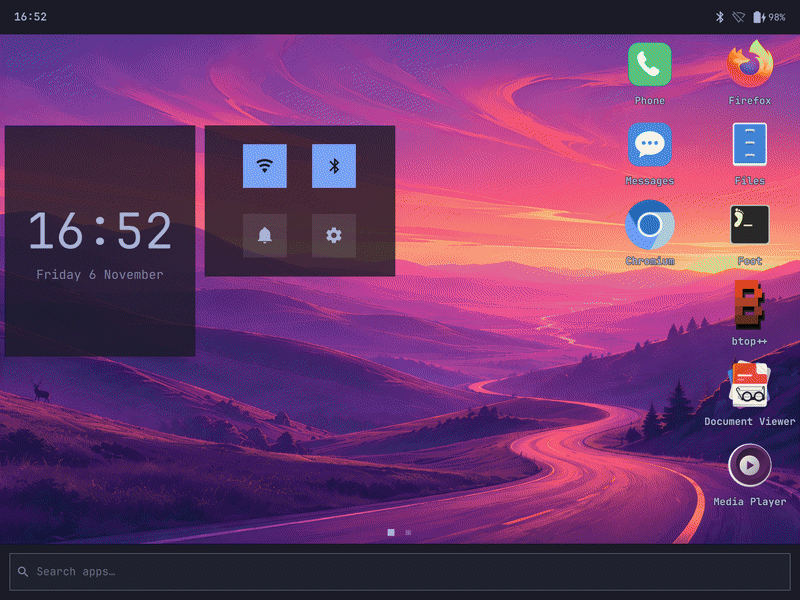
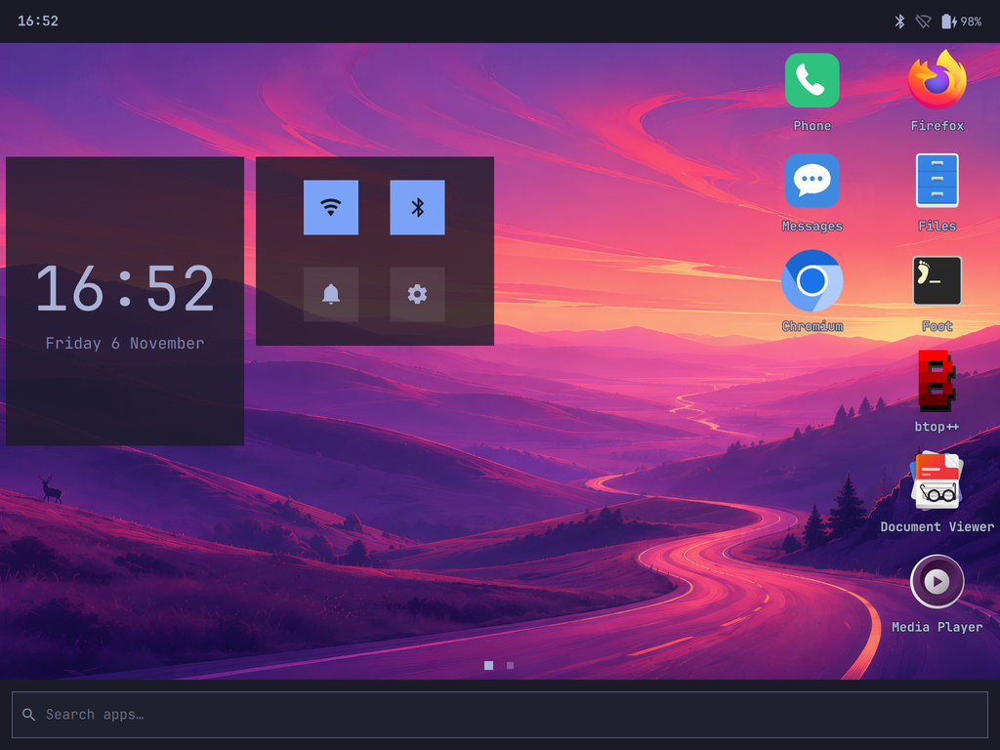
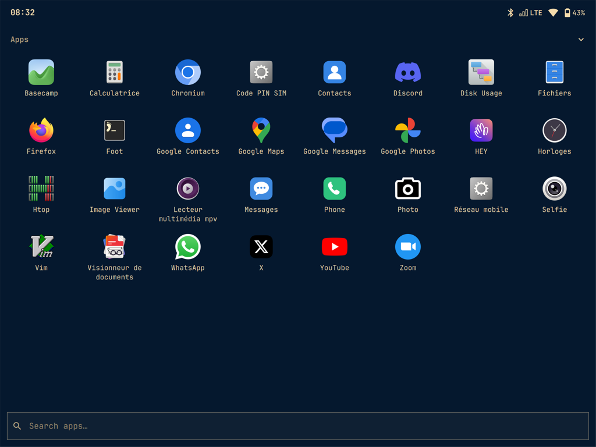
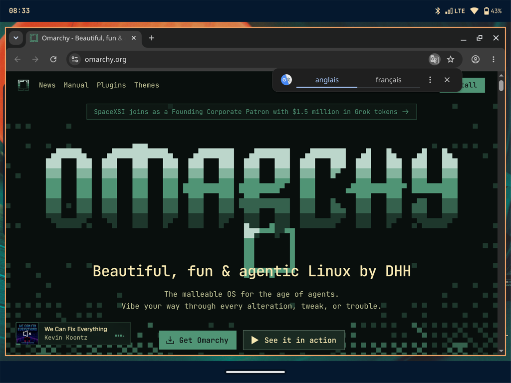
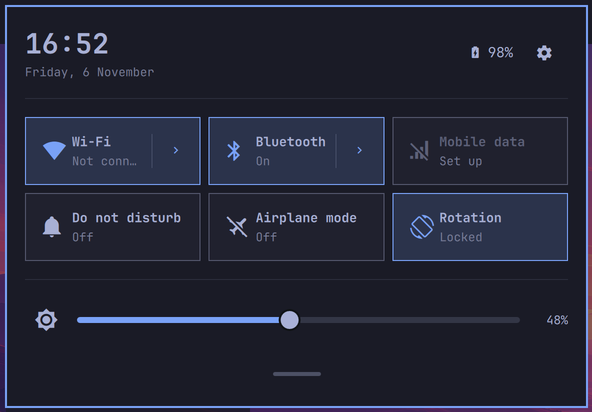
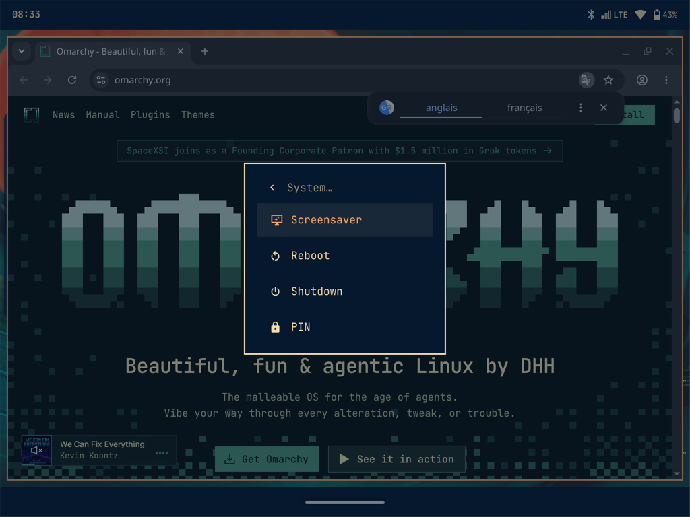
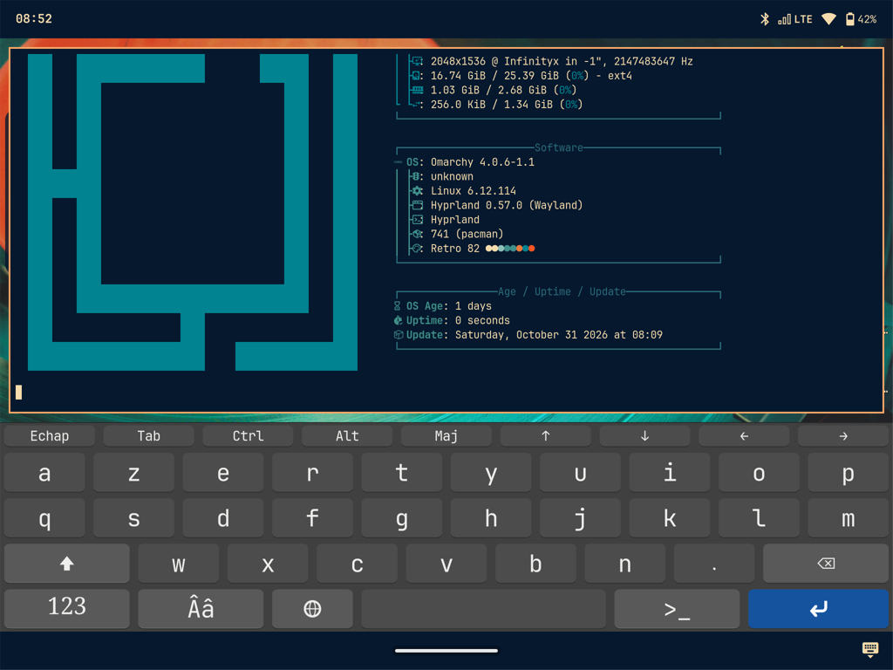

# Omarchy on the Samsung Galaxy Tab S2

[Omarchy](https://omarchy.org) (Hyprland and the Omarchy shell) with the
[omarchy-mobile](https://github.com/derekross/omarchy-mobile) touch layer, as a full tablet
desktop on the Samsung Galaxy Tab S2 8.0 LTE (SM-T715), on a mainline Linux 6.12 kernel. LTE,
calls and SMS included.

**Version 1.0.4.** It runs daily on one tablet. The published image went through its first boot on
that tablet, on a persistent root of its own next to its owner's system, and was checked there
before publication. No install by anyone else has been reported yet, and the install from stock
Android or TWRP has never been run end to end: see [the install guide](docs/INSTALL.md).

An unofficial port: not affiliated with Omarchy, omarchy-mobile or Samsung.



| Home | Apps | Chromium |
|---|---|---|
|  |  |  |

| Quick settings | System menu | Terminal and on-screen keyboard |
|---|---|---|
|  |  |  |

> **Do not rely on this tablet for an emergency call.** `shannond` refuses emergency numbers, and
> no emergency call was ever tried under Linux. Use a phone.

## What works

| Area | State |
|---|---|
| Boot | Omarchy at power-on, with the Omarchy splash and a read-write root; the first boot sets itself up with its progress on screen; a read-only rescue in RECOVERY |
| Desktop | Hyprland 0.57 and the Omarchy shell at scale 2 on the 1536x2048 panel; status bar, quick settings, app drawer, recents, home screens, back swipe, on-screen keyboard |
| Keys | Power, Home, cover, and the Back and Recent touch keys |
| Modem | LTE, calls, SMS, mobile data, airplane mode, Wi-Fi hotspot over LTE; a Modem tile and a switch to turn it off, now and at boot, or only while the screen is off |
| Wi-Fi, Bluetooth | WPA2 (the firmware has no WPA3); pairing from quick settings; keyboards, mice and audio over Bluetooth, with a pointer for the mouse; a Wi-Fi that fails to start is brought back by itself in seconds |
| Sound | speaker and microphone through PipeWire; vibration motor |
| Cameras | both, through libcamera's software ISP on the CPU: the Camera app with a preview, tap to focus, photos and video; Photo and Selfie in the drawer; the sensors' tables made at the first boot from your tablet's own firmware |
| GPS | position from the satellites through GeoClue, offline, the receiver on only while an app asks; a cold fix in about a minute under a clear sky, none indoors; a Location tile, off by default |
| Charging | stock Android's currents: about 1 A into the battery on a fast charger, 450 mA from a computer's port; stock's thermal rules on the battery thermistor |
| Power | 754 mW with the screen off, about 20 hours: the A57 cores offline, the GPU's power domain off while it idles, the Wi-Fi link asleep; the A53 cores scale from 400 MHz to 1.2 GHz, and since 1.0.1 the A57 cores from 800 MHz to 1.5 GHz and the GPU from 160 to 700 MHz |
| Sleep | suspend to RAM a minute after the screen goes dark on battery; Power, Home, the cover and a 12-hour battery check wake it; Wi-Fi, Bluetooth and the modem are off while it sleeps; its power draw is not measured yet |
| Security | ufw on, only SSH and DHCP on the USB cable come in; a screen lock you turn on by choosing a password |
| Browsers | Chromium on the GPU by default, Firefox beside it |
| Coding agents | Pi preinstalled; Claude Code through an opt-in installer in the app drawer (unofficial, 2.1.270 at most on 32-bit ARM) |

Not yet: hardware video decoding, headphone detection, the fingerprint reader. The tablet runs a
32-bit userland: its bootloader starts the CPU in AArch32.

Only one tablet was tested: SM-T715, bootloader `T715XXU2CRH1`, hardware revision 9. Other Tab S2
models are not covered.

## Install Omarchy

Two ways: flash the prebuilt ROM ([the install guide](docs/INSTALL.md)), or build
everything from source.

> **Read this first.**
> - Both blow the tablet's Knox warranty bit for good.
> - **The ROM replaces Android.** Your Android data stays on the tablet, unused.
> - **Never write** BOOTLOADER, EFS, m9kefs1-3, RADIO, CDMA-RADIO, PARAM or BOTA. EFS holds your
>   IMEI, and the modem's boot code programs eFuses.
> - Leave Linux with `systemctl reboot`. Do not hold hardware keys down to force a restart.
> - This comes with no warranty. You can lose your data and your tablet.

### Flash the ROM

**Status:** a first build of this release was installed fresh on the reference tablet, booted from
RECOVERY: its first boot, its copy to internal storage, the session, both cameras and the modem's
switch were checked there. The published image was then booted read-only and checked again, Wi-Fi
and Bluetooth included (`CHANGELOG.md` has what was tested). That tablet has no Android left,
so the Odin, Heimdall and TWRP steps were never run against a stock tablet. You would be the first:
expect rough edges, and report them.

[**The install guide**](docs/INSTALL.md) has every step. In short:

1. You need an SM-T715 on firmware `T715XXU2CRH1`, hardware revision 9 or later, not encrypted, with
   about 11 GB free on its internal storage, and a computer with Odin or
   [Heimdall](https://git.sr.ht/~grimler/Heimdall). Another firmware may boot, but the modem only
   accepts this exact RADIO image.
2. From the [latest release](https://github.com/elkir0/omarchy-tab-s2/releases), download the files.
   Unpack the image, make its checksum file, which the first boot checks the copy against, then
   check everything:

   ```bash
   xz -dk rootfs-omarchy.img.xz
   ```

   ```bash
   grep '  rootfs-omarchy.img$' SHA256SUMS > rootfs-omarchy.img.sha256
   ```

   ```bash
   shasum -a 256 -c SHA256SUMS
   ```

   On Windows, follow [the install guide](docs/INSTALL.md#2-put-the-image-on-the-tablet) instead.
3. Copy both files into `linux/` on the tablet's internal storage (`/sdcard/linux/`), and your SSH
   public key as `linux/authorized_keys` if you want to log in over SSH: the image has none.
4. Flash, in Download mode: Odin with `omarchy-tab-s2-1.0.4-AP.tar.md5`, or Heimdall:

   ```bash
   heimdall flash --BOOT boot.img --RECOVERY recovery.img
   ```

   From TWRP, flash `boot.img` to Boot and keep TWRP in RECOVERY.
5. The first boot copies the system into internal storage, about 4 minutes, with its progress on
   screen. It also takes the Wi-Fi and Bluetooth files from your tablet's own Android system
   partition, and the cameras' tables from its firmware. Then Omarchy starts.

Then:
- **Wi-Fi:** quick settings, Wi-Fi tile.
- **Mobile data and LTE:** open `Réseau mobile` in the app drawer and set your operator's APN.
  Without a SIM, turn the modem off with the Modem tile: it saves a fifth of the standby draw.
- **Password:** hold Power, then the PIN row. The default password is `alarm`, and `sudo` asks for
  nothing until you choose yours: choosing it turns on the screen lock, and `sudo` asks for it from
  then on.
- **Touch:** tap or pull down the top bar for quick settings. Swipe up from the home pill for home,
  swipe in from a side edge for back. Power: screen off and on.
- **Coding agents:** Pi is in the drawer; sign in with `/login` or an API key, never a Claude
  subscription. The drawer's Claude Code installer asks before it downloads anything.

To go back to Android, flash the stock firmware for your tablet.

### Build from source

From a stock tablet to the first boot, keeping Android at first. This is the short path;
[docs/DEPLOY.md](docs/DEPLOY.md) has each step in full, with what can go wrong. These steps ran on
the reference tablet, but nobody has followed them from a clean clone yet.

#### What you need

- An SM-T715 on Android 7.0, firmware `T715XXU2CRH1`, hardware revision 9, not encrypted.
- A Mac on Apple silicon. Linux hosts are untested, and a few scripts use macOS commands.
- Docker with arm/v7 emulation, `adb`, `dtc`, `python3`, `cmake`, `libusb`, `nc`, and an SSH key.
- A USB cable, and one to two hours of build time.

#### 1. Prepare the tablet

On the tablet, turn on Developer options, USB debugging and OEM unlocking, and accept the RSA
prompt. Connect it to the same Wi-Fi network as your Mac. Then check it:

```bash
S=<serial from adb devices -l>
```

```bash
for p in ro.product.model ro.boot.hw_rev ro.bootloader ro.crypto.state; do printf '%s: ' "$p"; adb -s "$S" shell getprop "$p"; done
```

Expect `SM-T715`, `9` or more, `T715XXU2CRH1`, `unencrypted`.

#### 2. Get the sources

The kernel tree needs a case-sensitive volume on macOS.

```bash
git clone https://github.com/elkir0/omarchy-tab-s2 && cd omarchy-tab-s2
```

```bash
hdiutil create -type SPARSEBUNDLE -fs "Case-sensitive APFS" -size 80g -volname smt715src .src.sparsebundle
```

```bash
mkdir -p src && hdiutil attach -mountpoint src .src.sparsebundle
```

```bash
git clone --branch v6.12.114 --depth 1 https://git.kernel.org/pub/scm/linux/kernel/git/stable/linux.git src/linux-6.12
```

```bash
git -C src/linux-6.12 switch -c t715-camera-mc
```

```bash
for s in bringup modem parity gps charger camera-af cpufreq power camera-mc; do git -C src/linux-6.12 am "$PWD"/kernel/patches/t715-$s/*.patch; done
```

Then build Heimdall into `src/heimdall`, as in
[docs/DEPLOY.md, 3.4](docs/DEPLOY.md#34-heimdall).

#### 3. Save what is unique to your tablet

The vendor files are not in this repository: they are Samsung's, so the build takes them from your
own tablet. This script writes nothing to the tablet:

```bash
ANDROID_SERIAL="$S" bash device/android/phase1_extract_noroot.sh
```

Then flash TWRP for `gts28ltexx` to RECOVERY, and back up Boot, EFS, m9kefs1-3, Modem and System
from its touch interface. USB does not work under TWRP on this tablet: copy the backup off under
Android. **Keep it: it is the only way back if EFS is ever damaged.** Put `boot.emmc.win` at
`dumps/stock/boot.img` ([docs/DEPLOY.md, 5.3](docs/DEPLOY.md#53-the-stock-boot-image-twrp)).

#### 4. Keep Android from rewriting RECOVERY

```bash
bash boot/patch-stock-boot.sh
```

```bash
adb -s "$S" reboot download
```

```bash
src/heimdall/build/bin/heimdall flash --BOOT out/stock-patched/boot.img
```

#### 5. Build everything

The kernel, the release's configuration ([kernel/README.md](kernel/README.md) also gives its fixed
build identity):

```bash
KBUILD_SKIP_ARM64=1 bash kernel/kbuild-mainline.sh --fragment gts28ltexx_cpufreq.config
```

The initramfs and the RECOVERY image:

```bash
bash boot/build-initramfs.sh --out out/initramfs-daily --knobs "t715.usbfn=ecm t715.failwait=300 t715.telnet=1" --modules out/mainline-cpufreq/modules.tar.xz
```

```bash
bash boot/pack-test-recovery.sh --initramfs out/initramfs-daily/initramfs.cpio.gz --out out/test-recovery-daily out/mainline-cpufreq
```

`t715.telnet=1` gives a development image the root shell on the USB link; releases leave it off.

The packages and the root image. The image takes your SSH key, and the two vendor files of step 3:

```bash
image/tools/repack-omarchy
```

```bash
for p in hyprgraphics omamobile-omarchy omatel-agent omaphone omamessages omamobile-shell libcamera omacam t715-camera t715-chromium t715-gps t715-claude-code pi-coding-agent; do image/tools/build-pkg $p; done
```

```bash
make -C modem/loader docker-cross && image/tools/stage-t715-modem && image/tools/build-pkg t715-modem
```

```bash
image/tools/build-rootfs --ssh-pubkey ~/.ssh/id_ed25519.pub
```

```bash
image/tests/verify-rootfs.sh "$PWD/image/out/rootfs-omarchy.img" ~/.ssh/id_ed25519.pub
```

The last line must say `RESULT: PASS`.

#### 6. Flash and boot

```bash
adb -s "$S" shell mkdir -p /sdcard/linux
```

Flash RECOVERY. Its first boot finds no image yet and returns to Android by itself:

```bash
bash device/flash-daily.sh
```

Push the image, which then boots it. Keep the USB cable in:

```bash
T715_ADB_WIFI=<tablet-ip>:5555 bash device/push-rootfs-image.sh --select image/out/rootfs-omarchy.img rootfs-omarchy.img "$(md5 -q image/out/rootfs-omarchy.img)"
```

#### 7. First boot

The Samsung logo, then Omarchy's session, which logs in by itself. SSH answers on the USB cable:

```bash
device/tssh
```

- **Touch:** tap or pull down the top bar for quick settings. Swipe up from the home pill for home,
  swipe in from a side edge for back. Power: screen off and on. Power held: the system menu.
- **Wi-Fi:** quick settings, Wi-Fi tile. In this first mode the root is in RAM, so nothing survives
  a reboot, and `systemctl reboot` goes back to Android.
- **Check it:** `systemctl --failed`, and `/usr/lib/t715-omarchy/smoke-check` on the tablet.

The image starts in English with QWERTY first and AZERTY in the keyboard's layout menu, on UTC. To
change that on the tablet:

```bash
sudo localectl set-locale LANG=fr_FR.UTF-8
```

```bash
sudo timedatectl set-timezone Region/City
```

#### 8. Make it permanent

Three steps, each in the guide. The second one replaces Android, and removing its data cannot be
undone:

1. [A persistent root](docs/DEPLOY.md#116-making-it-permanent-the-persistent-root): settings and
   Wi-Fi networks survive reboots.
2. [Linux in BOOT, a rescue in RECOVERY](docs/DEPLOY.md#117-without-android-linux-in-boot-androids-data-removed):
   Omarchy starts at power-on.
3. [The modem](docs/DEPLOY.md#118-with-the-modem): LTE, calls and SMS (the kernel above has the
   modem series). The first boot reads your NV data from EFS, read-only. It stays on the tablet.

Then set a password from the system menu's PIN row: it turns on the screen lock, and `sudo` asks
for it from then on. The default user is `alarm`, password `alarm`.

## What we found

Everything we learned about this hardware is public, register addresses included.

| Topic | Read |
|---|---|
| Hardware map: SoC blocks, GPIOs, I2C and SPI addresses, partitions | [HARDWARE_MAP](docs/hardware/HARDWARE_MAP.md), [BOARD_DT](docs/hardware/BOARD_DT.md), [DT_M2](docs/hardware/DT_M2.md) |
| Modem: Shannon SS333 over MIPI LLI, its boot and IPC protocol | [MODEM](docs/hardware/MODEM.md), [research/modem/](research/modem/) |
| Display, GPU, memory | [DISPLAY_M3](docs/hardware/DISPLAY_M3.md), [GPU](docs/hardware/GPU.md), [IOMMU](docs/hardware/IOMMU.md) |
| Cameras with no ISP, fingerprint reader | [CAMERA](docs/hardware/CAMERA.md), [FINGERPRINT](docs/hardware/FINGERPRINT.md) |
| Audio, Wi-Fi and Bluetooth, input, sensors | [AUDIO_M6](docs/hardware/AUDIO_M6.md), [WIFI_BT_M5](docs/hardware/WIFI_BT_M5.md), [INPUT_M4](docs/hardware/INPUT_M4.md), [SENSORS_M7](docs/hardware/SENSORS_M7.md) |
| GPS: the BCM4752, its boot protocol, Samsung's `gpsd` offline | [GPS](docs/hardware/GPS.md) |
| Power: battery, CPU, thermal, watchdog, SMP | [BATTERY](docs/hardware/BATTERY.md), [CPUFREQ](docs/hardware/CPUFREQ.md), [THERMAL](docs/hardware/THERMAL.md), [WATCHDOG](docs/hardware/WATCHDOG.md), [SMP_BRINGUP](docs/hardware/SMP_BRINGUP.md) |

### Drivers

All of them are in [kernel/patches/](kernel/patches/): the release kernel is `v6.12.114` plus 66
patches in nine series, listed in [kernel/README.md](kernel/README.md).

| Part | Driver |
|---|---|
| Exynos 5433 in 32-bit mode | SoC support, clocks, watchdog, CPU frequency scaling, the A57 cores' hot-unplug |
| Panel | `panel-samsung-s6e3ha2-tabs2` |
| Audio | `gts28-wm1814` machine driver, WM8998 and baseband link changes |
| Battery | `sm5703` fuel gauge, read-only, with the battery thermistor, and `sm5703` charger |
| Modem | `exynos5433-mipi-lli`, and `modem_v1`, Samsung's 3.10 driver ported to 6.12 |
| Touch keys, vibration | `tc300k`, `pwm-vibra` |
| Cameras | `t715-sensor`, the S5K4H5 and S5K6B2 sensors and the DW9807 focus motor as V4L2 subdevices, and `t715-camera`, raw capture with one media device per camera, for libcamera's software ISP |

The modem's userspace is in [modem/](modem/): `shannon-loader`, and `shannond`, which speaks
Samsung's IPC to the modem and ModemManager's D-Bus API to the desktop.

## Layout

| Path | What |
|---|---|
| `docs/` | the deployment guide, the hardware findings, the image |
| `kernel/` | the kernel as patch series, and its Docker build |
| `boot/` | the initramfs, the BOOT and RECOVERY image packer, sboot tools |
| `image/` | the root image: build steps, overlay, patched packages, tests |
| `device/` | scripts that drive the tablet |
| `modem/` | the modem stack: loader, daemon, units, call audio |
| `research/` | the modem's reverse engineering, the camera bring-up, the UCM generator |

## Credits and license

Built on [Omarchy](https://omarchy.org), [omarchy-mobile](https://github.com/derekross/omarchy-mobile)
by Derek Ross, Arch Linux ARM, and the Linux kernel. Written by
[elkir0](https://github.com/elkir0) with Claude Code.

GPL-2.0-or-later, with some parts under other licenses: see [NOTICE.md](NOTICE.md). No Samsung
firmware or blob is in this repository.
