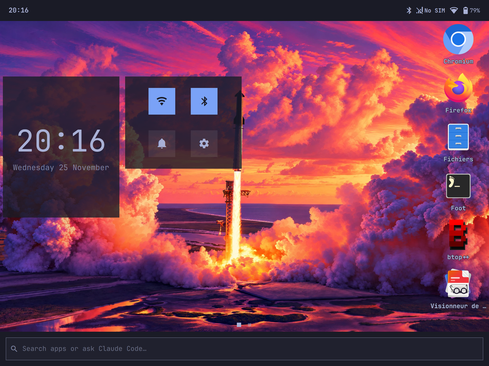
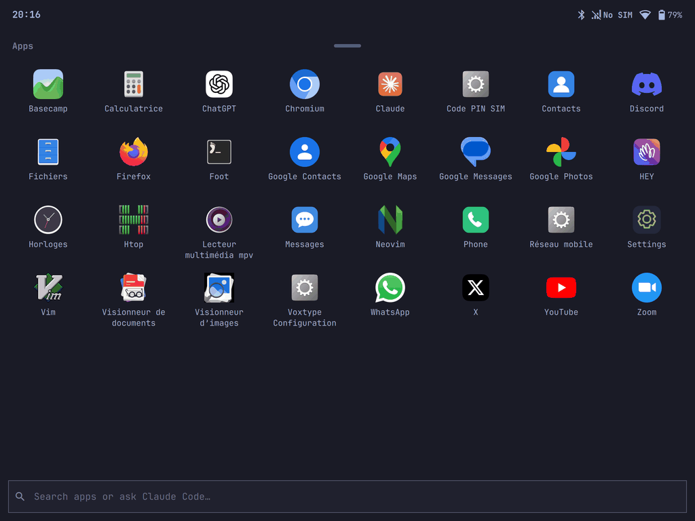
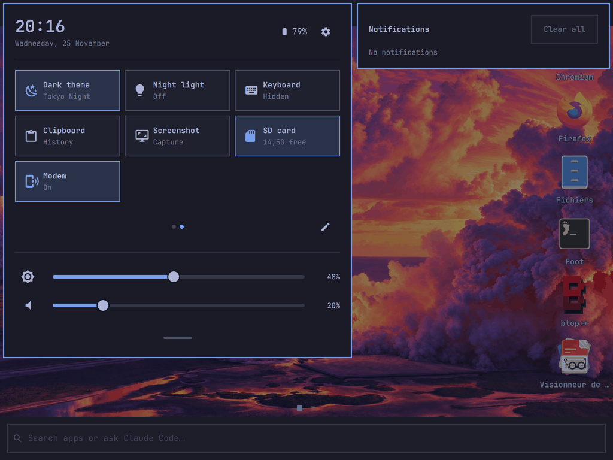
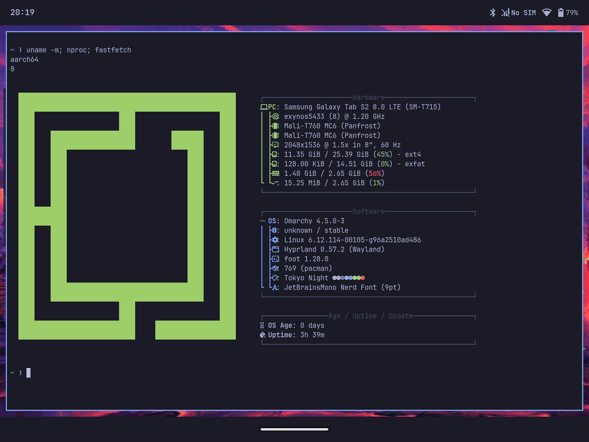
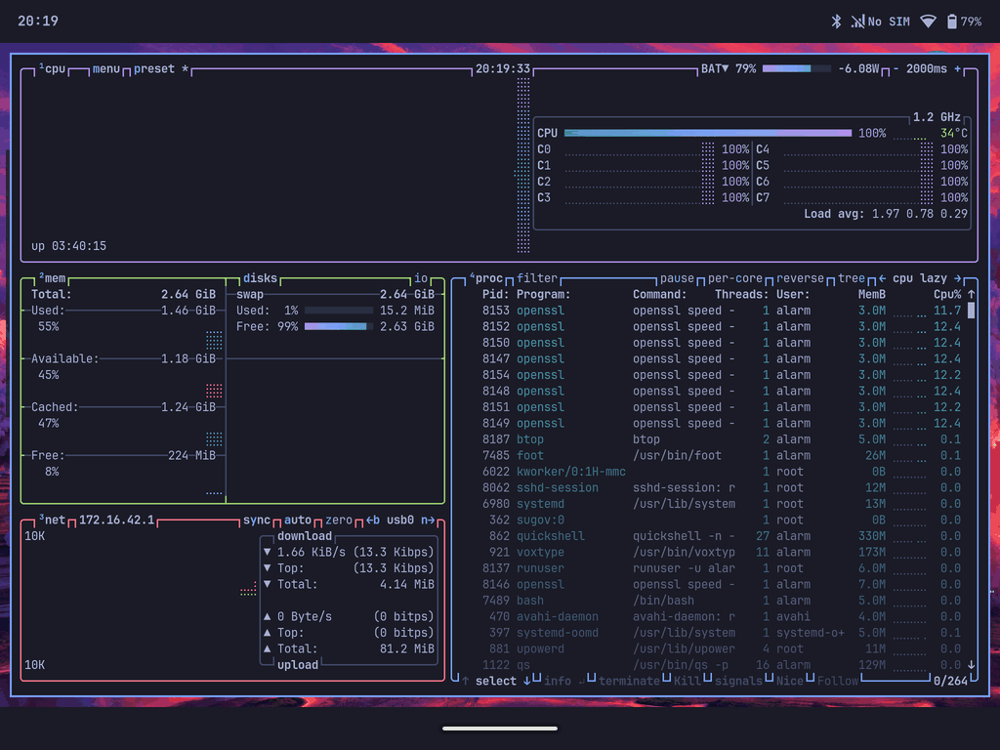
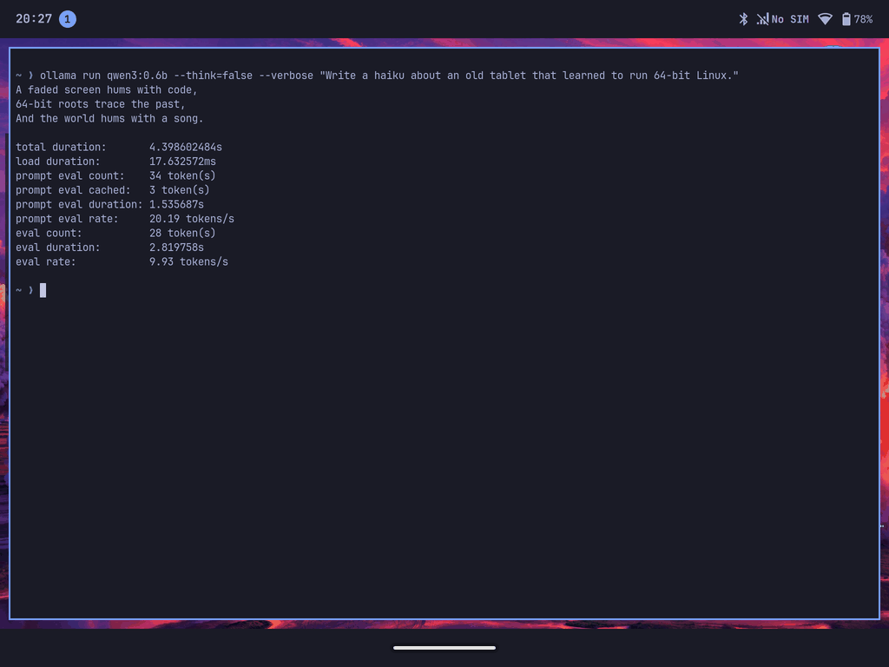
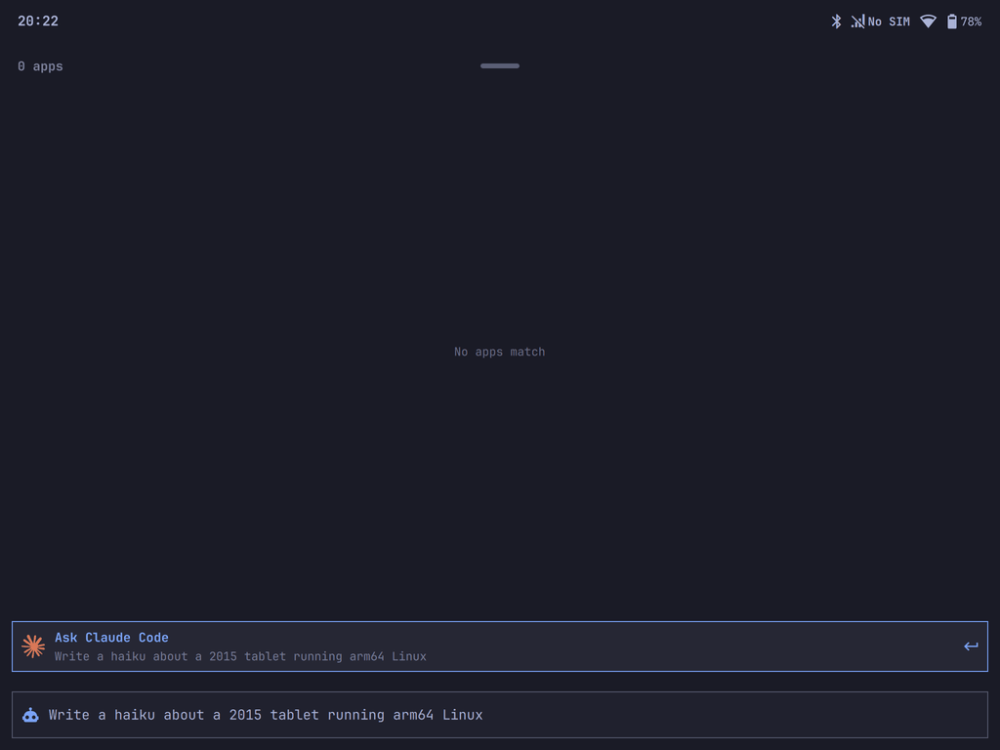
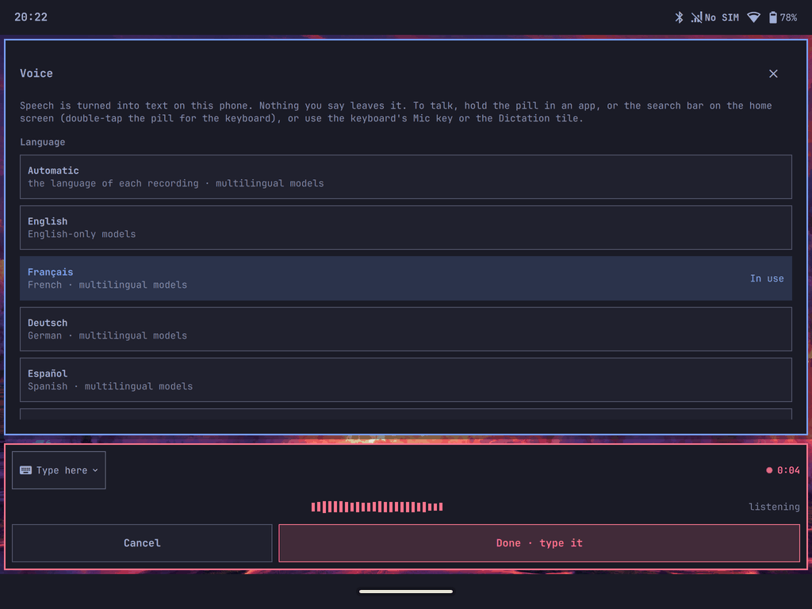
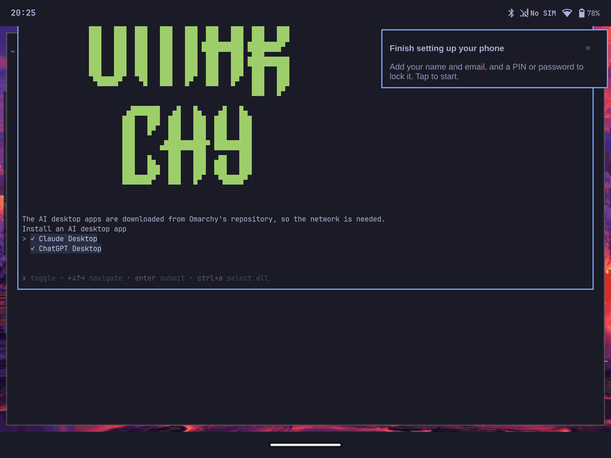

# Omarchy on the Samsung Galaxy Tab S2, in 64 bits

A 2015 tablet whose bootloader only starts 32-bit kernels now runs a modern **64-bit Linux
desktop**: [Omarchy](https://omarchy.org) 4.5 with the
[Omarchy Mobile](https://github.com/derekross/omarchy-mobile) touch layer, on all **eight cores**
of its Exynos 5433, on mainline Linux 6.12, with **AI built in**: Claude Code one question away
in the search bar, Claude Desktop and ChatGPT Desktop, dictation in your own language that never
leaves the tablet, and local models with Ollama.

**2.0.0 "Golden".** Download, flash once, and the tablet installs itself: [the guide](docs/INSTALL-ARM64.md).
It is the daily system of the reference tablet, a Galaxy Tab S2 8.0 LTE (SM-T715), since
2026-11-25.

An unofficial port: not affiliated with Omarchy, Omarchy Mobile or Samsung.


## Why it is worth a look

- **64 bits on a tablet locked to 32.** Samsung's bootloader starts the Exynos 5433 in AArch32,
  always. A loader of our own, in the PARAM partition, switches it to AArch64 at every boot and
  starts a 64-bit kernel, behind a boot screen drawn by the bootloader itself. It hands back to
  the bootloader whenever something is wrong, and a rescue in BOOT and RECOVERY puts it back if
  it is ever lost. ([The boot brick](https://github.com/elkir0/bnuuyloader), a fork of
  [bnuuyloader](https://github.com/meowybnuuy/bnuuyloader).)
- **All eight cores**, four Cortex-A53 and four Cortex-A57, with frequency scaling and thermal
  limits from the board's own tables. A soak of three hours with all eight busy passed.
- **Omarchy 4.5 and Omarchy Mobile at their latest**, built for this tablet: Hyprland, the
  Omarchy shell, a touch shell with an app drawer, gestures, quick settings and an on-screen
  keyboard, Omarchy's themes and menus. And the arm64 world: current packages from Arch Linux ARM
  and from Omarchy's own aarch64 channel.
- **AI, everywhere it fits.**
  - *Ask Claude Code* straight from the search bar: type a question instead of an app's name.
  - Claude Code, Claude Desktop, ChatGPT Desktop with Codex, OpenCode, Grok and the rest of
    Omarchy's AI menu, installed on the tablet from their official sources.
  - Dictation and a voice bar in your language, transcribed on the tablet by Whisper: nothing you
    say leaves it. Rebuilt for this tablet's CPU, which Omarchy's own build does not run on.
  - Local models with Ollama: a 0.6B model answers at about 10 tokens per second, offline.
  - A first-run setup that asks your name and a PIN, offers the AI apps and lets you pick your
    coding agent.
- **The tablet's own hardware**: the LTE modem, Wi-Fi, Bluetooth, sound, the motion sensors and
  rotation, the microSD card, the battery, the hardware and touch keys, the cover, the vibrator.

| Home | Apps | Quick settings |
|---|---|---|
|  |  |  |

| aarch64, eight cores | All eight at work | Local AI |
|---|---|---|
|  |  |  |

| Ask Claude Code | Dictation, in your language | First run: the AI apps |
|---|---|---|
|  |  |  |

## What works

On the reference tablet, in 64 bits, since 2026-11-25.

| Area | State |
|---|---|
| Install | one flash from a stock tablet: the installer copies the system, writes the kernel, saves PARAM and EFS, and builds the loader from the tablet's own PARAM; seven minutes on the reference tablet ([the guide](docs/INSTALL-ARM64.md)) |
| Boot | the loader in PARAM starts the 64-bit kernel at every power-on, behind a boot screen drawn by the bootloader; user space in about 13 s; a failed attempt hands the next boots to the rescue, then tries again |
| CPU | eight cores in AArch64: A53 from 400 MHz to 1.2 GHz, A57 from 800 MHz to 1.2 GHz, schedutil, thermal trips from the board's tables |
| Desktop | Hyprland 0.57 and the Omarchy shell on the 2048x1536 panel, GPU through Panfrost (Mali-T760); the touch shell: drawer, home, recents, quick settings, back gesture, on-screen keyboard; rotation |
| AI | Claude Code, Claude Desktop, ChatGPT Desktop, mise, Ollama, OpenCode and Grok start on the tablet; dictation and the voice bar in your language; Ask Claude Code from the search bar; the first-run setup |
| Keys | Power, Home, the cover, and the Back and Recent touch keys |
| Wi-Fi, Bluetooth | Wi-Fi (WPA2) and Bluetooth up at every boot |
| Modem | the LTE modem's processor online at every boot, with its interface: the Modem tile, the mobile network settings, the call card; a SIM is not tested yet in 64 bits |
| Sound | the WM1814 codec through PipeWire; the microphone feeds dictation |
| Sensors, storage | accelerometer, gyroscope and magnetometer; the microSD card |
| Battery | the fuel gauge, charging over USB |
| Security | ufw on; a PIN or password from the first-run setup, and the screen lock |
| Way back | the loader hands back to the bootloader when it has nothing sound to start; the installer, which stays in BOOT and RECOVERY as the rescue, says so and lets the loader try again, and puts the loader back into PARAM from the saved stock copy if it was lost |

**Not yet in 64 bits**, where the 32-bit release had them: suspend to RAM, Android apps
(Waydroid), the cameras' user space, the A57 cores above 1.2 GHz, and the modem with a SIM
(registration, data, SMS, calls) tested end to end. [The roadmap](arm64/docs/ROADMAP.md) has the
order.

One tablet was tested: SM-T715, bootloader `T715XXU2CRH1`, hardware revision 9. Other Tab S2
models are not covered.

> **Do not rely on this tablet for an emergency call.** No emergency call was ever tried under
> Linux. Use a phone.

## Install

| Route | For | How |
|---|---|---|
| **Download, flash, it installs** | anyone with the tablet | **2.0.0**: copy `omarchy-arm64.img` to a microSD card, flash the installer once with Odin or Heimdall, and the tablet installs itself, then starts Omarchy's first-run setup. [The guide](docs/INSTALL-ARM64.md) |
| **The long route** | power users | every step by hand from a computer, each with its way back: [GO-ARM64.md](https://github.com/elkir0/bnuuyloader/blob/main/t715/docs/GO-ARM64.md) |

The loader cannot ship as a file: PARAM is Samsung's firmware and holds one tablet's own data. So
the installer builds it on the tablet, from that tablet's own PARAM, and checks the result against
the one sha256 it was built for before writing it ([docs/INSTALL-ARM64.md](docs/INSTALL-ARM64.md),
section 7; [docs/ARM64.md](docs/ARM64.md)).

> **Read this first.** Installing blows the Knox warranty bit for good, replaces Android, and
> writes PARAM, CACHE, BOOT and RECOVERY. It needs the firmware `T715XXU2CRH1`: the installer
> checks it and writes nothing on another. It never writes BOOTLOADER, EFS, m9kefs1-3 or RADIO;
> it saves PARAM and EFS (your IMEI) to the image's folder before it writes PARAM. This comes
> with no warranty: you can lose your data and your tablet.

## Two bricks, two repositories

| Brick | Where | What |
|---|---|---|
| **The boot** | [elkir0/bnuuyloader](https://github.com/elkir0/bnuuyloader) | the loader in PARAM, its boot screen, the 64-bit kernel's patches and configuration, the rescue, and what was found about the tablet's bootloader |
| **The system** | this repository: [arm64/](arm64/README.md) | the Omarchy 4.5 image for arm64: its build, the packages patched for the tablet, the AI integration, the tools and tests, and its releases |

## Build it yourself

The image builds in arm64 containers, on a Mac with Apple silicon or an aarch64 Linux machine:

```bash
cd arm64/rootfs
bash build.sh --target omarchy --ssh-pubkey ~/.ssh/id_ed25519.pub
```

[arm64/README.md](arm64/README.md) has what is in it and how to change it;
[arm64/docs/ROOTFS.md](arm64/docs/ROOTFS.md) everything about the image.

## What we found

Everything learned about this hardware is public, register addresses included.

| Topic | Read |
|---|---|
| The 64-bit boot: the loader in PARAM through the boot logo's vulnerability, the eight cores without PSCI, the bootloader's own code | [the fork's findings](https://github.com/elkir0/bnuuyloader/blob/main/t715/docs/FINDINGS.md), [ARM64](docs/ARM64.md) |
| The 64-bit image, and why some of Omarchy's aarch64 packages do not run on this CPU (ARMv8.0) | [arm64/](arm64/README.md), [ROOTFS](arm64/docs/ROOTFS.md) |
| Hardware map: SoC blocks, GPIOs, I2C and SPI addresses, partitions | [HARDWARE_MAP](docs/hardware/HARDWARE_MAP.md), [BOARD_DT](docs/hardware/BOARD_DT.md), [DT_M2](docs/hardware/DT_M2.md) |
| Modem: Shannon SS333 over MIPI LLI, its boot and IPC protocol | [MODEM](docs/hardware/MODEM.md), [research/modem/](research/modem/) |
| Display, GPU, memory | [DISPLAY_M3](docs/hardware/DISPLAY_M3.md), [GPU](docs/hardware/GPU.md), [IOMMU](docs/hardware/IOMMU.md) |
| Cameras with no ISP, fingerprint reader | [CAMERA](docs/hardware/CAMERA.md), [FINGERPRINT](docs/hardware/FINGERPRINT.md) |
| Audio, Wi-Fi and Bluetooth, input, sensors | [AUDIO_M6](docs/hardware/AUDIO_M6.md), [WIFI_BT_M5](docs/hardware/WIFI_BT_M5.md), [INPUT_M4](docs/hardware/INPUT_M4.md), [SENSORS_M7](docs/hardware/SENSORS_M7.md) |
| GPS: the BCM4752, its boot protocol | [GPS](docs/hardware/GPS.md) |
| Power: battery, CPU, thermal, watchdog, SMP | [BATTERY](docs/hardware/BATTERY.md), [CPUFREQ](docs/hardware/CPUFREQ.md), [THERMAL](docs/hardware/THERMAL.md), [WATCHDOG](docs/hardware/WATCHDOG.md), [SMP_BRINGUP](docs/hardware/SMP_BRINGUP.md) |

## Layout

| Path | What |
|---|---|
| `arm64/` | **the 64-bit system**: the image's build, its packages, tools and tests |
| `boot/` | the initramfs and the BOOT and RECOVERY images: the 64-bit port's rescue, and the 32-bit release's boot |
| `kernel/` | the kernel as patch series (the 64-bit kernel adds the fork's patches) |
| `modem/` | the modem stack: loader, daemon, units, call audio, packaged for both |
| `device/` | scripts that drive the tablet over the USB cable |
| `docs/` | the 64-bit port's page, the hardware findings, the legacy release's guides |
| `image/` | the 32-bit release's root image (legacy) |
| `research/` | the modem's reverse engineering, the camera bring-up, the UCM generator |

## Legacy: the 32-bit release

The project began as a 32-bit (ARMv7) port, released from 1.0.0 to 1.0.5: LTE, calls and SMS,
both cameras, GPS, suspend, Android apps through Waydroid. It is no longer developed, and stays
downloadable and documented: [docs/LEGACY-ARM32.md](docs/LEGACY-ARM32.md), with
[its install guide](docs/INSTALL.md) and [the changelog](CHANGELOG.md).

## Credits and license

Built on [Omarchy](https://omarchy.org),
[Omarchy Mobile](https://github.com/derekross/omarchy-mobile) by Derek Ross, Arch Linux ARM and
the Linux kernel. The 64-bit boot is a port of
[bnuuyloader](https://github.com/meowybnuuy/bnuuyloader) by bnuuy: the entry through the boot
logo and the monitor call that makes 64 bits possible are theirs
([who made what](https://github.com/elkir0/bnuuyloader/blob/main/CREDITS.md)). Written by
[elkir0](https://github.com/elkir0) with Claude Code.

GPL-2.0-or-later, with some parts under other licenses: see [NOTICE.md](NOTICE.md). No Samsung
firmware or blob is in this repository.
